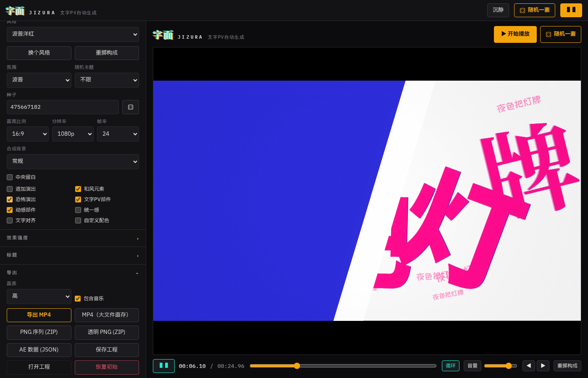
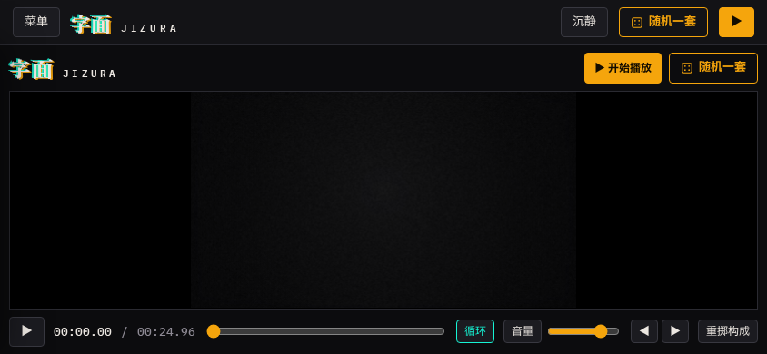
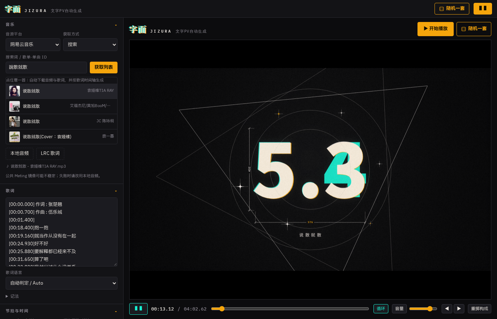

# 字面 JIZURA-web

中文歌词视频（文字 PV）自动生成器 —— JIZURA 引擎的 Web 版。把歌词文本或带时间戳的 LRC 变成逐句演出的动态视频：选风格、点开始、全屏播放，导出 MP4 / PNG 序列 / AE 工程，全部在浏览器本地完成。



## 功能

- **一键开始**：点「开始播放」（或空格键）从头自动播放；「随机一套」（骰子图标 / R 键）重掷风格×氛围×构成后自动播放
- **侧边栏调参**：音乐 / 歌词 / 节拍 / 风格与画面 / 效果强度 / 标题 / 导出 / 界面语言，全部分区可折叠
- **音乐**：Meting 搜索/歌单/单曲（网易云、QQ、酷狗、百度），点歌自动下载音频+LRC 生成时间轴；或本地音频 + LRC 文件
- **导出**：MP4（含音频）、大文件直存、PNG 序列 ZIP、透明 PNG ZIP、AE JSON、工程 JSON
- **沉静模式**：右上角「沉静」一键屏蔽全部设置，只留画面与屏幕边缘的小把手，再点（或 Esc）恢复


- **移动端**：竖屏提示旋转，横屏侧边栏收进抽屉，导出自动限 1080p



- **多语言**：默认简体中文，可切 繁體 / EN / JA / KO，引擎部件名同步切换

## 使用

```bash
pnpm install          # 安装依赖
pnpm dev              # 开发服务器 http://localhost:5173
pnpm build            # 产物 → dist/（相对路径 base，可放任意子目录）
pnpm preview          # 预览 dist
pnpm smoke            # 无头浏览器冒烟测试（需先: pnpm exec playwright install chromium）
```

## 效果图

| 桌面端 | Meting 载入后自动播放 |
| --- | --- |
|  |  |

| 沉静模式 | 手机横屏抽屉 |
| --- | --- |
|  |  |

更多截图见 [docs/](docs/)：`desktop.png`（桌面全貌）、`meting.png`（在线音乐）、`serene.png`（沉静模式）、`mobile-portrait.png`（竖屏提示）、`mobile-drawer.png`（抽屉）、`mobile-landscape.png`（横屏）。

## 结构

- `src/engine/` — JIZURA 引擎（01_util … 11q_sets，不含旧 UI 12_ui.js）+ mp4-muxer
- `src/engine.js` — 按构建顺序加载引擎，导出 `window.J`
- `src/store.js` — 全局状态：播放循环 / replan / 导出 / Meting 载入
- `src/meting.js` — Meting 音乐源（qijieya / injahow / moeyao 三个镜像互备）
- `src/i18n.js` — UI 字典（zh-Hans 默认，zh-Hant / en / ja / ko）
- `src/labels/` — 部件名 / 风格名运行时字典
- `src/components/` — Sidebar（全部参数）、Stage（画布 + 传输条）、controls
- `scripts/smoke.mjs` — Playwright 冒烟测试（截图输出到 `docs/`）

## 说明

- 音乐来自公共 Meting 镜像，偶发限流时请改用本地音频
- 导出使用浏览器 WebCodecs，需要较新的 Chrome / Edge
